# Olist Analytics Pipeline

Projeto de estudo em Análise e Engenharia de Dados: um pipeline ETL local, feito com Python e Pandas, que transforma o [Brazilian E-Commerce Public Dataset by Olist](https://www.kaggle.com/datasets/olistbr/brazilian-ecommerce) em arquivos Parquet organizados em camadas Bronze, Silver e Gold e os disponibiliza em um dashboard interativo com Streamlit.

> **Status:** em desenvolvimento. O plano e o progresso estão nos [Milestones](https://github.com/MarcioLima79/olist-analytics-pipeline/milestones) do repositório.

## Dataset

O dataset reúne informações de pedidos de uma plataforma brasileira de e-commerce: pedidos, itens, clientes, produtos, vendedores, pagamentos, avaliações e localização geográfica.

Os arquivos de dados **não são versionados** neste repositório. O dataset é disponibilizado sob a licença [CC BY-NC-SA 4.0](https://creativecommons.org/licenses/by-nc-sa/4.0/), que exige atribuição, restringe o uso comercial e requer que adaptações compartilhadas mantenham a mesma licença. Consulte os termos antes de redistribuir amostras. Veja [Como executar](#como-executar) para obter os dados.

## Perguntas de negócio

**Vendas**

1. Como as vendas evoluíram ao longo do tempo?
2. Quais categorias de produtos apresentam maior volume de vendas?
3. Qual é o valor médio dos pedidos?
4. Quais estados concentram maior volume de compras?

**Entregas**

5. Qual é o tempo médio de entrega dos pedidos?
6. Qual percentual de pedidos foi entregue após a data estimada?
7. Quais estados apresentam maior ocorrência de atrasos?

**Experiência do cliente**

8. Qual é a avaliação média dos pedidos?
9. Existe alguma relação entre atrasos na entrega e avaliações dos clientes?

## Arquitetura



- **Bronze:** dados originais em Parquet, sem alteração de conteúdo.
- **Silver:** dados limpos, padronizados e validados, tabela por tabela.
- **Gold:** conjuntos analíticos prontos para responder às perguntas de negócio e alimentar o dashboard.

Todas as camadas são persistidas localmente em Parquet. Cada camada é sobrescrita a cada execução, então rodar o pipeline duas vezes gera o mesmo resultado.

## Tecnologias

| Tecnologia         | Utilização                                  |
| ------------------ | ------------------------------------------- |
| Python             | Linguagem principal                         |
| Pandas             | Manipulação e transformação dos dados       |
| uv                 | Gerenciamento do ambiente e dependências    |
| PyArrow            | Leitura e escrita de Parquet                |
| Streamlit e Plotly | Dashboard interativo                        |
| Pytest             | Testes dos indicadores e do reprocessamento |
| Git/GitHub         | Versionamento e acompanhamento do plano     |

## Estrutura do repositório

```text
olist-analytics-pipeline/
├── data/            # raw, bronze, silver, gold (não versionados)
├── docs/            # diagrama e decisões de transformação
├── notebooks/       # exploração do dataset
├── src/             # extraction, transformation, loading e pipeline.py
├── dashboard/       # app.py (Streamlit)
├── tests/
├── pyproject.toml
└── README.md
```

## Como executar

1. Instale o [uv](https://docs.astral.sh/uv/).
2. Clone o repositório e instale as dependências:

   ```bash
   uv sync
   ```

3. Baixe o dataset no [Kaggle](https://www.kaggle.com/datasets/olistbr/brazilian-ecommerce) e extraia os arquivos CSV em `data/raw/`.
4. Execute o pipeline:

   ```bash
   uv run python -m src.pipeline
   ```

5. Inicie o dashboard:

   ```bash
   uv run streamlit run dashboard/app.py
   ```

Os comandos poderão ser ajustados conforme a implementação.

## Resultados

Em construção. Os principais achados e as capturas do dashboard serão adicionados ao concluir a Entrega 4.

## Fora do escopo da primeira versão

AWS, Apache Spark, Apache Airflow, Kafka, processamento em tempo real, banco de dados externo e infraestrutura em nuvem. Podem ser avaliados em versões futuras, depois que o processo local estiver funcionando.

## Princípio de desenvolvimento

**Aprender antes de automatizar. Compreender antes de transformar. Validar antes de apresentar.**
